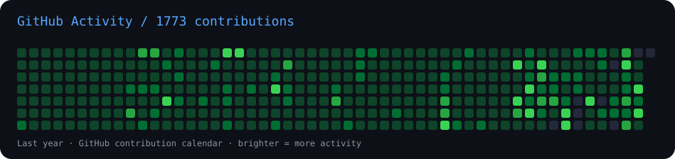

# Tino Britty

**Backend & Systems Engineer · Postgraduate @ PSG Tech · India**

I build reliable systems across backend, web, Android, and developer tooling. My focus is on clear interfaces, maintainable architecture, and software that remains understandable as it grows.

[Website](https://tinobritty.me) · [LinkedIn](https://linkedin.com/in/brittytino) · [Email](mailto:brittytino08@gmail.com)

---

## Engineering Focus

- Backend architecture, distributed systems, and predictable failure handling.
- Developer tools that improve reliability and reduce maintenance effort.
- Practical applications for academic, civic, and productivity workflows.
- Open-source development, documentation, and code quality.

## Technical Stack

**Languages:** Java · TypeScript · Kotlin · Python  
**Backend & Infrastructure:** PostgreSQL · Kafka · Docker  
**Web & Mobile:** Next.js · Android · Flutter

## Selected Projects

- **[PSGMX](https://github.com/brittytino/psgmx)** — Placement portal with role-based access and real-time data synchronisation.
- **[t_launcher](https://github.com/brittytino/t_launcher)** — Minimal Android launcher designed to reduce distraction.
- **[PodLink](https://github.com/brittytino/podlink)** — Accountability groups with real-time communication and progress tracking.
- **[rescuee](https://www.npmjs.com/package/rescuee)** — TypeScript toolkit for runtime validation and structured error handling.

## GitHub Activity

<!-- LIVE:START -->
Updated **2026-11-09 UTC** · updated daily.

| Last-year contributions | Commits | Pull requests | Issues | PR reviews |
| ---: | ---: | ---: | ---: | ---: |
| 1768 | 852 | 47 | 2 | 9 |

### Top Repositories
Public, original, non-archived projects; ranked by stars, then latest push.

| Project | Description | Language | Stars |
| :--- | :--- | :--- | ---: |
| [psgmx](https://github.com/brittytino/psgmx) | High-performance placement portal featuring role-based access control, PostgreSQL real-time sync, and automated analytics. Powered by Flutter, Supabase, and Dart. | TypeScript | 20 |
| [t\_launcher](https://github.com/brittytino/t_launcher) | Minimal Android launcher for focus and productivity | Kotlin | 8 |
| [podlink](https://github.com/brittytino/podlink) | PodLink: small accountability pods with real-time chat, streaks, crisis tools, and AI-assisted moderation/matching | TypeScript | 6 |
| [cyber-sop-assistant](https://github.com/brittytino/cyber-sop-assistant) | A fully local Cybercrime SOP assistant for India, combining a FastAPI backend, React frontend, and Ollama-powered RAG system to provide guidance, resources, and reporting workflows without cloud dependencies. | Python | 4 |
| [fossa](https://github.com/brittytino/fossa) | FOSSA is a free, 100% open-source, self-hosted AI engineering and code review platform | TypeScript | 2 |

**Languages across original repos:** TypeScript (21) · JavaScript (4) · Python (2) · Kotlin (1) · HTML (1) · Vue (1). Counts are repositories, not proficiency.

### Recent Pull Requests
- [feat(windows): rank coding-agent fallback instead of declaring it](https://github.com/BasedHardware/omi/pull/12430) — BasedHardware/omi · open
- [fix(docs): escape math syntax in ADR-0009 to prevent MDX prerender ReferenceError](https://github.com/infinitica-org/hellosmart/pull/147) — infinitica-org/hellosmart · merged
- [fix(docs): escape math syntax in ADR-0009 to prevent MDX prerender ReferenceError](https://github.com/infinitica-org/hellosmart/pull/146) — infinitica-org/hellosmart · merged
- [chore(release): promote qa to main](https://github.com/infinitica-org/hellosmart/pull/145) — infinitica-org/hellosmart · merged
- [chore(release): merge dev into qa](https://github.com/infinitica-org/hellosmart/pull/144) — infinitica-org/hellosmart · merged

Contribution counts follow GitHub’s calendar rules and the workflow token’s visibility; they are not a count of every commit ever made. PRs above are the most recently updated public PRs.
<!-- LIVE:END -->

## Writing

- [PSGMX: Building a Real-Time Placement Portal](https://www.tinobritty.me/blog/psgmx-placement-app)
- [Podlink Case Study: Accountability Through Small Pods](https://www.tinobritty.me/blog/podlink-case-study)
- [Digitizing Government SOP Workflows](https://www.tinobritty.me/blog/government-sop-digitization)
- [t_launcher: Designing a Minimal Android Launcher](https://www.tinobritty.me/blog/t-launcher)

---

> Readable code scales better than clever code.

Activity and repository data are updated automatically each day. [Automation details](AUTOMATION.md)
